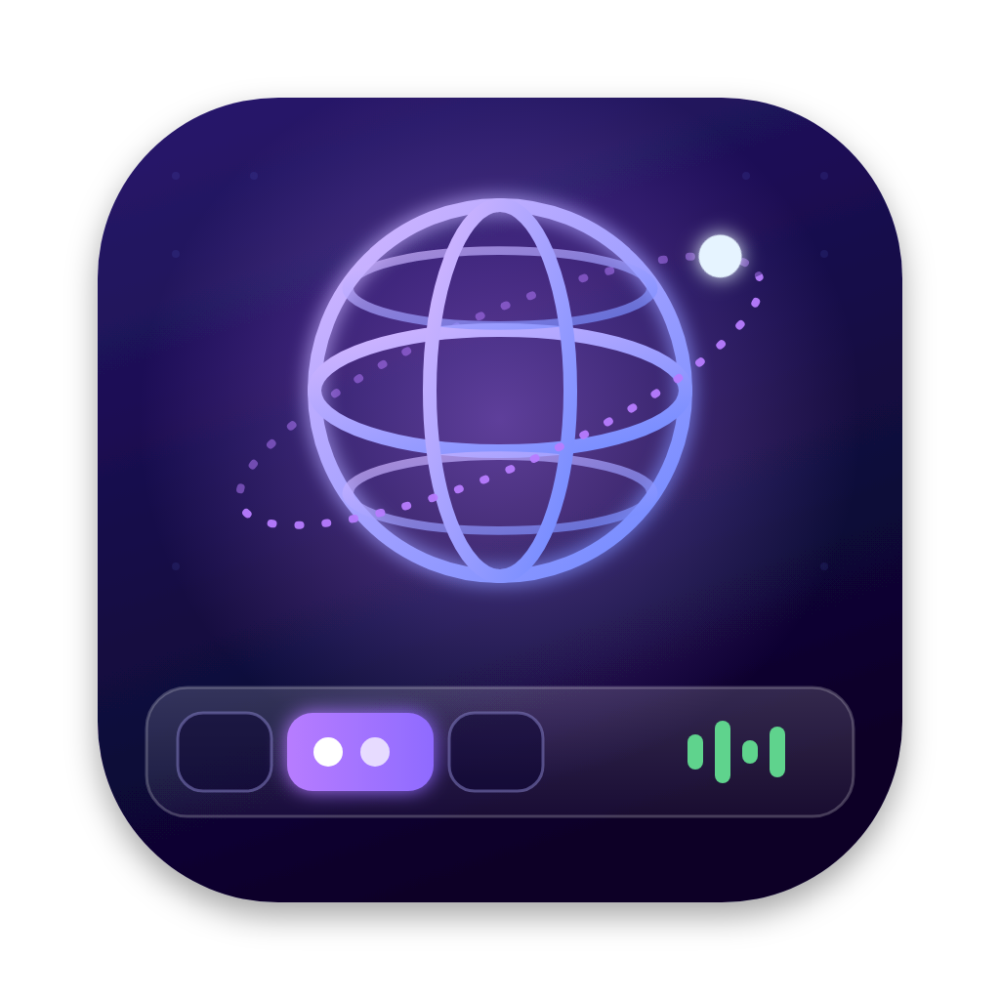

# Gizmobar



A fast, native macOS status bar written in Swift. A panel on every display,
AeroSpace workspaces, rich now playing, 3D models, and TypeScript plugins.

Gizmobar replaces a SketchyBar setup that spent its time starting shell
processes. Here nothing on the render path starts a process: providers read
macOS APIs in-process, push events onto one bus, and SwiftUI redraws at most
once per frame.

> Status: in development. See the [roadmap](docs/roadmap.md) for what's done.

Website and getting started guide: <https://thomasmelak.github.io/gizmobar/>

## Install

Requires macOS 14 or newer (Liquid Glass on macOS 26).

**Download**

Grab [Gizmobar.dmg](https://github.com/thomasmelak/gizmobar/releases/latest/download/Gizmobar.dmg),
open it and drag **Gizmobar** onto **Applications**. The app isn't notarized by Apple, so the
first time you open it macOS will refuse; go to System Settings > Privacy & Security and click
**Open Anyway** (or run `xattr -dr com.apple.quarantine /Applications/Gizmobar.app`).

**Homebrew**

```sh
brew tap thomasmelak/gizmobar https://github.com/thomasmelak/gizmobar
brew trust thomasmelak/gizmobar
brew install --cask gizmobar
```

Current Homebrew refuses casks from a tap you haven't trusted, hence `brew trust`; older
versions don't have the command and can skip that line.

Homebrew clears the quarantine flag, links `gizmo` onto your PATH and starts the bar. Update
with `brew upgrade --cask gizmobar`.

**One-line installer**

```sh
curl -fsSL https://raw.githubusercontent.com/thomasmelak/gizmobar/main/install.sh | bash
```

The installer downloads the latest release into `/Applications`, links `gizmo` into
`~/.local/bin`, copies the example config and starts the bar. Nothing is built locally, so no
Xcode is needed.

**From source** (developers only): see [Build from source](#build-from-source) below.

After a DMG or Homebrew install, `gizmo config init` copies the example config into
`~/.config/gizmobar` (it never overwrites). A DMG install links `gizmo` into `~/.local/bin`
the first time the app starts.

## Uninstall

Any of these removes the app, the `gizmo` command and the bar's state. Your config in
`~/.config/gizmobar` is kept.

- Homebrew: `brew uninstall --cask --zap gizmobar`
- Script: `curl -fsSL https://raw.githubusercontent.com/thomasmelak/gizmobar/main/uninstall.sh | bash`
  (or `make uninstall` in a clone)

## Build from source

Requires macOS 14+ (Liquid Glass on macOS 26) and Swift 6. The Command Line
Tools are enough; use `make test` rather than plain `swift test` there, since
it adds the swift-testing framework path that SwiftPM misses without Xcode.

```sh
make test          # unit tests
make config        # copy examples/gizmobar into ~/.config/gizmobar
make run           # build Gizmobar.app and launch it
make install       # install to /Applications and link `gizmo` into ~/.local/bin
make dmg           # build/Gizmobar.dmg
```

Local builds only: sign with a stable identity so privacy grants survive rebuilds
(release builds are signed in CI; users never sign anything):

```sh
scripts/make-local-signing-cert.sh   # once: a self-signed identity make app uses
# or pick one yourself:
SIGN_IDENTITY="Apple Development: Your Name (TEAMID)" make app
```

## The `gizmo` CLI

```sh
gizmo ping
gizmo trigger vpn.status up=true    # push your own events onto the bus
gizmo reload                        # re-read config, theme and icon packs
gizmo state
gizmo icons missing                 # apps the icon packs don't cover, most used first
gizmo icons init my-icons           # start a custom icon pack
gizmo new my-plugin                 # scaffold a TypeScript plugin
gizmo debug                         # plugin render times and budgets
gizmo config init                   # copy the example config (never overwrites)
```

## Plugins

Widgets can be written in TypeScript. `gizmo new my-plugin`, add it to
your layout, save, and it's on the bar. See [docs/plugins.md](docs/plugins.md).

## 3D models

Plugins can put a glTF, GLB or USDZ model on the bar with `ui.scene`, play
its animation clips, recolor parts and open a popover you can orbit. A
still model is swapped for a snapshot, so it costs nothing at rest. There
is a dot globe too: add `"globe"` to your layout, or use `ui.globe` with
your own markers. See the `status-pet` and `uptime-globe` examples and
[docs/plugins.md](docs/plugins.md#3d-scenes).

## AeroSpace

With AeroSpace 0.21+ the bar keeps one `aerospace subscribe` stream open, so
`aerospace.toml` needs no bar callbacks. On older versions set
`[aerospace] mode = "callback"` and add:

```toml
exec-on-workspace-change = ['gizmo', 'trigger', 'aerospace.workspace']
```

With several displays, each bar shows the workspaces AeroSpace has on that
monitor (`[aerospace] per_monitor = false` lists them all everywhere).

## Now playing

Spotify and Music work out of the box (macOS asks once to let Gizmobar
control them). For any other app (browsers, podcasts) install
[mediaremote-adapter](https://github.com/ungive/mediaremote-adapter) and
point the bar at it:

```toml
[media]
adapter = "~/.local/share/mediaremote-adapter"   # holds mediaremote-adapter.pl + the framework
```

Without it the bar falls back to `nowplaying-cli` when that's installed.
The visualizer listens to each app on its own through Core Audio taps
(macOS 14.2+, asks for audio capture once) and analyzes the sound the way
[cava](https://github.com/karlstav/cava) does. It draws 3D ridges in the
album's colors by default; `visualizer = "bars"` gives flat bars and
`"off"` hides it. Deny audio capture or set `spectrum = false` and it
animates on its own.
Apps that aren't players (calls, videos) show in the pill by name, and the
popover lists media apps, call apps and browsers playing now or heard in
the last 10 minutes (`[media] audio_sources = ["bundle.id"]` adds more).

Lyrics come from [LRCLIB](https://lrclib.net), synced when it has timings
(`[lyrics] enabled = false` to turn them off).

### Spotify

Signing in adds the up-next queue beside the album art and your playlists
to the popover. Create an app at
[developer.spotify.com](https://developer.spotify.com/dashboard) with the
redirect URI `http://127.0.0.1:43821/callback`, then set its client ID:

```toml
[spotify]
client_id = "your client id"
```

Open the Now Playing popover on a Spotify track and choose **Sign in to
Spotify**. The refresh token is kept in the login Keychain.

## Configuration

`~/.config/gizmobar/`:

```
config.toml          # layout, bar, icons, aerospace (see examples/gizmobar)
themes/<name>.toml   # design tokens; missing keys fall back to Gizmo. 12 themes are
                     # bundled (Gizmo, Nord, Dracula, Catppuccin...); yours win by name
icon-packs/<id>/     # extra or replacement icon packs
plugins/<id>/        # TypeScript plugins, see docs/plugins.md
```

App icons resolve per bundle ID: per-app override, then `style = "system"`
for real macOS icons everywhere, otherwise your custom pack, then the other
packs in order, then the fallback you pick.

The custom pack is whichever pack `custom_pack` names (Custom Icons by
default, then Tefer Line). Start your own with `gizmo icons init my-icons`,
drop `<bundle-id>.svg` files into it, and the bar picks them up live, no reload.

## Layout

```
Sources/
  GizmoCore/       events, bus, config, theme, icon resolver, plugin manifest
  GizmoIPC/        Unix socket protocol for the CLI
  GizmoProviders/  system, network, power, audio, displays, media, AeroSpace
  GizmoPlugins/    JavaScriptCore plugin runtime
  GizmoScene/      glTF reader, RealityKit scenes, dot globe
  GizmoUI/         panels per display, widgets, icon rendering
  Gizmobar/        the app
  gizmo/           the CLI
sdk/               @gizmobar/sdk for TypeScript plugins
icon-packs/        bundled packs
examples/gizmobar/ example ~/.config/gizmobar
```

See [docs/architecture.md](docs/architecture.md) for how the pieces fit.

## Releasing

Push a tag like `v0.1.0`, or run the **Release** workflow from the Actions tab with a tag name.
It runs the tests, builds a universal app, signs it once in CI, and publishes `Gizmobar.zip`
and `Gizmobar.dmg` to a GitHub release. The one-line installer and the download link always point
at the latest release. The workflow also opens a pull request that bumps the version and
sha256 in `Casks/gizmobar.rb`; merge it and `brew upgrade` offers the new version.

Releases are signed with a self-signed certificate stored in the `SIGNING_CERT_P12` and
`SIGNING_CERT_PASSWORD` secrets, so privacy grants survive updates. Create it once with
`scripts/make-signing-cert.sh`. Without the secrets the app is ad-hoc signed.
